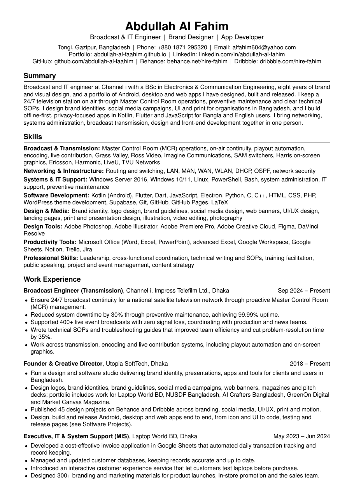

# Abdullah Al Fahim · CV

**Broadcast & IT Engineer · Brand Designer · App Developer** 
Tongi, Gazipur, Bangladesh

Latest version: <b>V2026.11.015</b> · 4 pages · ATS-friendly

  

## What's inside

My full, general CV, not tailored to any one job:

- Work experience at Channel i, Utopia SoftTech and Laptop World BD
- Software and development projects: TaskBell, Taka, Roktobondhu, Zakat Calculator, Telecast Time, PhotoCard Studio and more
- Education, publications, certifications, leadership, awards, languages and references
- Author of the LinkedIn newsletters *Brand Design Conversation* and *ThinkLab*

## ATS-friendly by design

- One column, standard section headings, no tables, icons, images or text boxes
- Real, selectable text with Unicode mappings for every font, so parsers read it exactly as written
- Every link is printed as visible text, not hidden behind a word

## Contact

- Email: [alfahim604@yahoo.com](mailto:alfahim604@yahoo.com)
- LinkedIn: [linkedin.com/in/abdullah-al-fahim](https://linkedin.com/in/abdullah-al-fahim)
- Portfolio: [abdullah-al-faahim.github.io](https://abdullah-al-faahim.github.io)
- Design work: [Behance](https://behance.net/hire-fahim) · [Dribbble](https://dribbble.com/hire-fahim) · [Pinterest](https://pinterest.com/utopiadesignsbd)

Only the latest version is published here. The PDF is attached to the [latest release](https://github.com/abdullah-al-faahim/cv/releases/latest).
